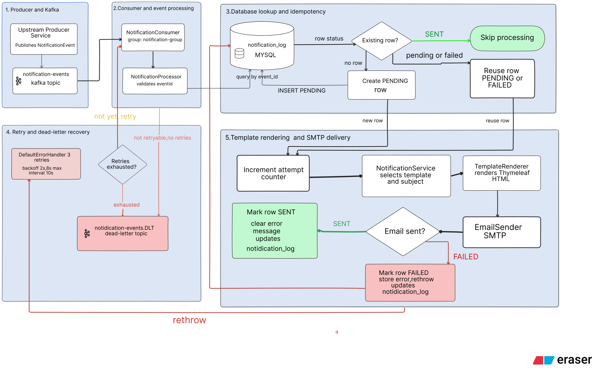

<p align="center">
  <h1>Notification Service</h1>
  <strong>Event-Driven Email Delivery for an E-Commerce Platform</strong>
  <br/>
  A Spring Boot microservice that consumes Kafka events and delivers transactional emails asynchronously.
</p>

<p align="center">
  
  
  
  
  
</p>

---

The Notification Service handles email delivery for an event-driven e-commerce platform. Instead of having other services send emails themselves, they publish events to Kafka, and this service takes care of the notification.

It supports order confirmations, order cancellations, welcome emails, and password reset OTPs. Each notification is tracked in MySQL, with database-backed idempotency, retry handling, and a dead-letter topic to help manage processing failures.

<p align="center">
  <a href="#notification-events">Events</a> •
  <a href="#how-it-works">How It Works</a> •
  <a href="#reliability">Reliability</a> •
  <a href="#tech-stack">Tech Stack</a> •
  <a href="#project-structure">Project Structure</a> •
  <a href="#configuration-and-environment-setup">Configuration</a>
</p>

## Notification Events

The Notification Service listens to the `notification-events` Kafka topic and processes events published by other services in the e-commerce platform.

Based on the event type, it generates and sends transactional HTML emails using Thymeleaf templates and SMTP.

### Supported Events

| Event Type | Trigger | Email Notification |
|---|---|---|
| `ORDER_CONFIRMED` | Payment succeeds and the order is confirmed | Order confirmation email containing order items and total amount |
| `ORDER_CANCELLED` | Payment fails or expires, resulting in order cancellation | Order cancellation email containing order items and total amount |
| `USER_REGISTERED` | A new user registers | Welcome email |
| `PASSWORD_RESET_OTP` | A user requests a password reset | Password reset OTP email with expiry information |

### Event Processing

- Events are consumed asynchronously through Apache Kafka.
- The service identifies the event type and processes the corresponding notification.
- Thymeleaf templates generate dynamic HTML email content.
- SMTP handles email delivery.

The Notification Service is the dedicated owner of email delivery for the platform. Other services publish events instead of sending emails directly.

## How It Works

The Notification Service processes each incoming Kafka event through a pipeline of event consumption, database-backed idempotency checks, template rendering, and SMTP email delivery.

### Processing Flow

1. **Event publishing:** Upstream services publish a `NotificationEvent` to the `notification-events` Kafka topic.
2. **Event consumption:** `NotificationConsumer`, running in the `notification-group` consumer group, receives the event and passes it to `NotificationProcessor`.
3. **Event validation and lookup:** `NotificationProcessor` validates that the event has an `eventId` and looks up its record in the `notification_log` table.
4. **Idempotency check:**
   - If the event already has status `SENT`, processing is skipped.
   - If no record exists, a new `PENDING` record is created.
   - If a record is already `PENDING` or `FAILED`, the existing record is reused.
5. **Notification preparation:** The attempt counter is incremented. `NotificationService` selects the email subject and Thymeleaf template based on the event type.
6. **Template rendering:** `TemplateRenderer` processes the selected template with event data and shared variables to produce the HTML email body.
7. **Email delivery:** `EmailSender` uses Spring's `JavaMailSender` to send the HTML email through the configured SMTP server.
8. **Status update:** On success, the log is marked `SENT` and its previous error message is cleared. On a runtime failure, the log is marked `FAILED`, the error is stored, and the exception is rethrown so Kafka's error handler can handle the failed record.

### Architecture Flow



### Database-backed Idempotency

Each notification event is tracked by its `eventId`. The `notification_log` table enforces a unique constraint on this field, while the processor checks the stored status before sending an email. This prevents an event already marked `SENT` from being processed again and allows existing `PENDING` or `FAILED` records to be reused during another processing attempt.

This is idempotent event processing, not a guarantee of exactly-once email delivery. For example, an SMTP send may succeed while the subsequent database status update fails, which can cause another send attempt.

### Retry and Dead-Letter Handling

For retryable processing failures, the configured Kafka `DefaultErrorHandler` uses exponential backoff: an initial interval of 2 seconds, a multiplier of 2, and a maximum interval of 10 seconds, with up to 3 retries. After retries are exhausted, the failed record is published to `notification-events.DLT`.

`IllegalArgumentException` is configured as non-retryable, so invalid events such as those missing an `eventId` are not retried.

## Reliability

The Notification Service is designed to handle duplicate events, temporary email delivery failures, and invalid messages without losing track of what happened.

It combines database-backed idempotency with Kafka's retry and dead-letter mechanisms. Each notification also has a database record that tracks its processing status and attempts.

### Behaviour at a glance

| Situation | What happens |
|---|---|
| An event arrives again after its email was sent | Skipped because its record is already `SENT` |
| Two identical events arrive concurrently | The unique constraint on `event_id` prevents a duplicate log record |
| SMTP delivery fails | The record is marked `FAILED`, and the exception is passed to Kafka |
| A retry succeeds | The record becomes `SENT`, and the previous error is cleared |
| All retries are exhausted | The message is published to `notification-events.DLT` |
| An event has no `eventId` | Rejected by the processor without retrying |
| A message cannot be deserialized | Handled through Kafka's deserialization error handling and dead-letter recovery |

### Idempotency

Every notification event carries a unique `eventId`. The `notification_log` table enforces a unique constraint on `event_id`, so the same event cannot create multiple notification records.

Before sending an email, `NotificationProcessor` checks whether a record already exists:

| Existing record | Behaviour |
|---|---|
| No record | Create a new `PENDING` record and process the event |
| `PENDING` | Continue processing using the existing record |
| `FAILED` | Attempt processing again using the existing record |
| `SENT` | Skip the event |

There is also a concurrent duplicate safeguard. If two processing attempts try to create a record for the same event at the same time, the database unique constraint rejects the duplicate insert. The processor catches the resulting `DataIntegrityViolationException` and skips that insertion.

### Tracking processing attempts

The `notification_log` table keeps a record of each notification's processing history.

A few fields are particularly useful when investigating failures:

| Field | Purpose |
|---|---|
| `status` | Current state: `PENDING`, `SENT`, or `FAILED` |
| `attempts` | Number of processing attempts |
| `errorMessage` | Most recent processing error, limited to 1,000 characters |
| `createdAt` | When the notification record was created |
| `updatedAt` | When the record was last updated |

The attempt counter is incremented before notification processing begins. This means Kafka retries that reach the processor are reflected in the same database record rather than creating separate records.

### Retry and Dead-Letter Handling

When notification processing fails, the processor marks the record as `FAILED`, stores the error message, saves the updated record, and rethrows the exception.

That exception is passed to Kafka's `DefaultErrorHandler`, configured in `KafkaErrorHandlingConfig`.

The retry configuration uses exponential backoff:

| Setting | Configuration |
|---|---|
| Initial backoff | 2 seconds |
| Backoff multiplier | 2 |
| Maximum backoff interval | 10 seconds |
| Maximum retries | 3 |
| Total processing attempts | 4 (1 initial + 3 retries) |

For example, if the SMTP server remains unavailable:

| Attempt | Approximate time | Result |
|---|---:|---|
| 1 | 0 seconds | Fails |
| 2 | 2 seconds | Fails |
| 3 | 6 seconds | Fails |
| 4 | 14 seconds | Fails; message sent to DLT |

The maximum interval is configured as 10 seconds, although this example only reaches an 8-second backoff.

`IllegalArgumentException` is explicitly configured as non-retryable. This covers invalid events such as those missing an `eventId`. Deserialization failures are also handled as non-retryable by Spring Kafka's default fatal-exception handling.

After recovery, failed messages are published to the `notification-events.DLT` topic.

### Handling failed events again

A failed notification does not need a new database record when it is processed again.

For example, imagine the SMTP server is temporarily unavailable:

1. The first attempt fails, and the record becomes `FAILED`.
2. Kafka retries the message.
3. The processor finds the existing record using its `eventId`.
4. The attempt counter increases, and email processing runs again.
5. If the SMTP operation succeeds, the record becomes `SENT` and the previous error message is cleared.

The same existing record is reused throughout these attempts.

There is another situation worth considering: if the service stops after creating a `PENDING` record but before processing finishes, Kafka can redeliver the uncommitted message. When that happens, the processor can continue using the existing record instead of creating another one.

### What it does not guarantee

The service prevents an event already marked `SENT` from triggering another email attempt. However, this is not an exactly-once email delivery guarantee.

Consider a situation where the SMTP server accepts an email, but the application stops before updating the database record to `SENT`.

When Kafka redelivers that event, the database may still show `PENDING` or `FAILED`. The processor will attempt to send the email again, and the recipient could receive a duplicate.

This is an important limitation of coordinating database updates and external SMTP delivery: the service cannot make both operations atomic.

The current implementation improves reliability through event tracking, retries, and duplicate checks, but it cannot guarantee that every email is delivered exactly once.

## Tech Stack

The service uses Java and Spring Boot, with Kafka handling incoming events and Spring Mail taking care of email delivery. I’ve kept the responsibilities separate: event consumption, notification processing, email rendering, and delivery each have their own place in the codebase.

| Technology | How it's used |
|---|---|
| Java 21, Maven | Application development and dependency management |
| Spring Boot 4.1.x | Application framework |
| Spring for Apache Kafka | Consuming notification events and handling retries and dead-letter publishing |
| Spring Data JPA, MySQL | Persisting notification processing records in `notification_log` |
| Thymeleaf | Rendering HTML email templates |
| Spring Mail (SMTP) | Sending emails |
| Jackson | Serializing and deserializing Kafka messages |
| JUnit 5, Mockito | Writing unit tests |

### Local development setup

Kafka runs in a Docker container using `apache/kafka:latest`. I reuse the container across development sessions and start it with `docker start kafka` when needed. MySQL runs locally on the development machine.

The service connects to Kafka at `localhost:9092` and MySQL at `localhost:3306`. It also starts an embedded web server on port `8084`, although the service currently exposes no REST endpoints. Its primary responsibility is consuming Kafka events and sending emails.

## Project Structure

I’ve organised the project around what each part of the service is responsible for. The structure is intentionally straightforward, so someone exploring the repository can find the relevant code without having to navigate a complicated package hierarchy.

```text
notification-service/
├── docs/
│   └── images/
│       └── notification-processing-flow.svg
├── src/
│   ├── main/
│   │   ├── java/com/aashir/notificationservice/
│   │   │   ├── config/
│   │   │   ├── consumer/
│   │   │   ├── entity/
│   │   │   ├── event/
│   │   │   ├── repository/
│   │   │   ├── sender/
│   │   │   └── service/
│   │   └── resources/
│   │       ├── application.properties
│   │       └── templates/email/
│   └── test/
├── pom.xml
└── README.md
```

### What lives where?

| Package | Responsibility |
|---|---|
| `config` | Kafka topic and error-handling configuration |
| `consumer` | Receives events from the `notification-events` topic |
| `event` | Defines the notification event and its type |
| `entity` | Stores notification log data and processing status |
| `repository` | Handles database access for notification logs |
| `service` | Processes events, coordinates notification delivery, and renders templates |
| `sender` | Handles the email-sending abstraction and SMTP implementation |

The email templates live under `src/main/resources/templates/email/`, separate from the Java code. `order.html` is shared by order confirmation and cancellation emails, while `welcome.html` and `password-reset-otp.html` handle the other notification types. Common email layout elements are kept in `fragments.html`.

This separation means I can update the content or layout of an email without changing the event-processing logic that triggers it.

The processing flow and how these components work together are covered in [How It Works](#how-it-works).

## Configuration and Environment Setup

The service keeps its runtime configuration in `application.properties`. Connection details and credentials are supplied separately, so sensitive values don't need to be written directly into the application configuration.

### Application Configuration

The application runs on port `8084` and uses the following local services:

| Setting | Configuration | Purpose |
|---|---|---|
| Application name | `notification-service` | Identifies the Spring Boot application |
| Server port | `8084` | Embedded web server port |
| Database | `notification_db` | Stores notification processing records |
| Kafka broker | `localhost:9092` | Receives notification events |
| Kafka topic | `notification-events` | Topic consumed by the service |
| Consumer group | `notification-group` | Identifies the notification consumer group |

The MySQL connection uses `createDatabaseIfNotExist=true`, allowing MySQL to create the database if it doesn't already exist. Hibernate uses `ddl-auto=update` to update the database schema based on the entity mappings.

### Environment Variables

The service reads database and email credentials through environment variables:

| Variable | Used for |
|---|---|
| `DB_USERNAME` | MySQL username |
| `DB_PASSWORD` | MySQL password |
| `MAIL_USERNAME` | SMTP email account |
| `MAIL_PASSWORD` | SMTP password or app password |

The project imports an optional local `.env` file through:

```properties
spring.config.import=optional:file:.env[.properties]
```

For local development, create a `.env` file in the project root:

```properties
DB_USERNAME=your_mysql_username
DB_PASSWORD=your_mysql_password

MAIL_USERNAME=your_email@gmail.com
MAIL_PASSWORD=your_email_app_password
```

Replace these placeholder values with your own credentials. The `.env` file is already included in `.gitignore`, so it should remain local and must not be committed to GitHub.

### Email and Application Settings

Email delivery uses Gmail SMTP with port `587` and STARTTLS enabled.

The service also has two application-specific properties:

| Property | Purpose |
|---|---|
| `app.brand-name` | Brand name displayed in email templates |
| `app.shop-url` | Shop URL used by email templates |

Their current local development values are `E-Commerce` and `http://localhost:5173`, respectively.

Keeping these values configurable makes it easier to adjust the email branding and frontend URL without changing the Java code.

### Configuration Note

The repository currently contains `application.properties`, but does not yet include a committed `.env.example`. The actual credentials are intentionally kept outside the repository.
